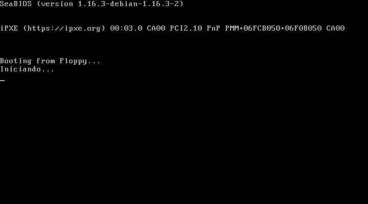
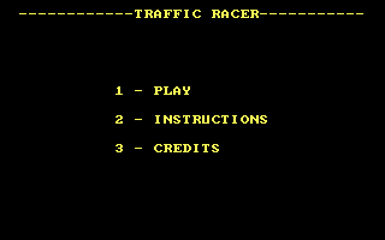
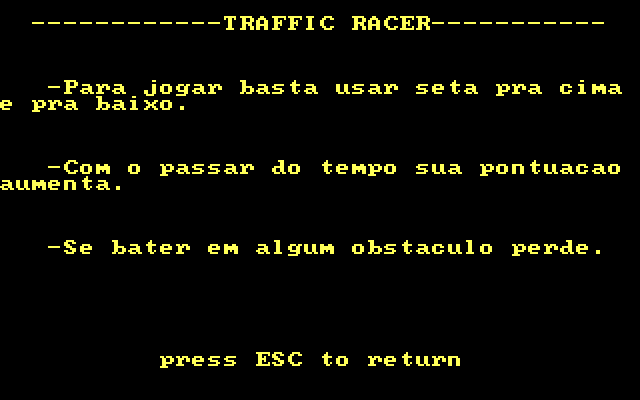
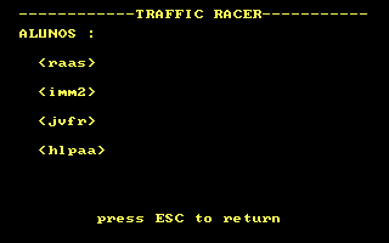
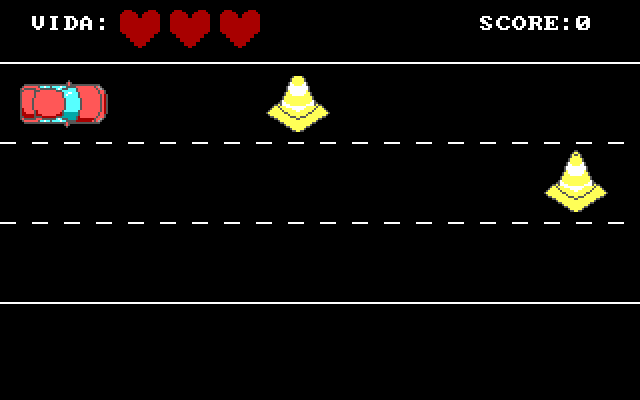
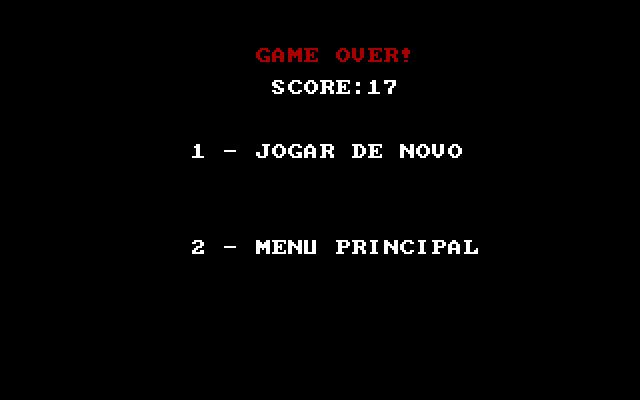
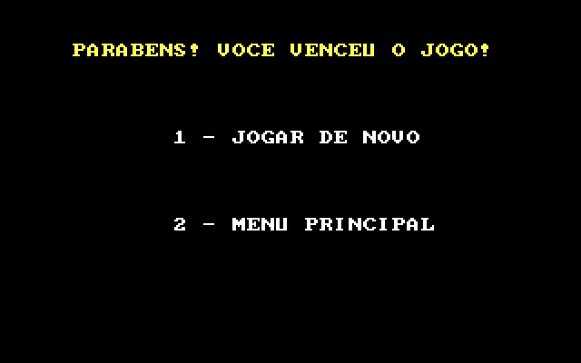

# Traffic Racer

Bootloader de dois estágios em assembly x86. A BIOS sobe o primeiro setor, esse setor puxa o segundo, e o segundo carrega o jogo. Não tem sistema operacional no meio: a partir daí é interrupção de BIOS e modo de vídeo 13h.

O jogo se chama Traffic Racer. Um carro vermelho fica na pista e cones vêm no sentido contrário. São três vidas. Se a pontuação passa de 2000, acaba a corrida.

Feito na disciplina de Infraestrutura de Software do CIn-UFPE, período 2023.1. No centro essa cadeira é a IF677.

## Telas

O primeiro estágio não escreve nada, só lê o disquete. A primeira coisa que aparece é o segundo estágio (`Iniciando...`) e, em seguida, o menu.















As imagens saíram do QEMU, com `screendump` no monitor, sem retoque.

## Como o boot funciona

Tudo em modo real, 16 bits. A imagem é um disquete de 100 setores de 512 bytes.

| Onde | O que é |
| --- | --- |
| Setor 1 do disco, memória `0x7C00` | `boot1`. A BIOS coloca esse setor aí se achar a assinatura `0xAA55` nos dois últimos bytes. |
| Setor 2, memória `0x500` | `boot2`. Um setor. |
| Setor 3 em diante, memória `0x7E00` | `kernel.asm`, o jogo. O segundo estágio lê 20 setores (10 KiB). |

O endereço físico em modo real é `(segmento << 4) + offset`. Por isso `boot2` vai para o segmento `0x50` (offset 0), que dá `0x500`, e o kernel vai para o segmento `0x7E0`, que dá `0x7E00`. `0x7C00` é o lugar fixo em que a BIOS larga o primeiro setor; `0x7E00` começa logo depois dele.

`boot1` zera `DS` e `ES`, reseta o disquete (int 13h, AH=0) e lê o setor 2 (trilha 0, cabeça 0) para `0x500`. Se a leitura falha, tenta de novo. Aí salta para `0x500`.

`boot2` imprime `Iniciando...` com a int 10h, espera um pouco (int 15h, AH=86h) e lê os 20 setores do kernel para `0x7E00`. Em seguida salta para esse endereço.

O kernel entra no modo 13h (320x200, 256 cores), desenha o menu e, a partir daí, o jogo. Os sprites estão em `sprite.asm` (o carro, o cone, o coração). Cada pixel é uma cor da paleta VGA desenhada com a int 10h.

Na partida, seta pra cima, seta pra baixo, W ou S mudam de faixa. ESC volta ao menu. No game over e na vitória, 1 joga de novo e 2 volta ao menu. A pontuação que aparece na tela é o contador interno dividido por 20; a vitória dispara quando o contador passa de 2000.

## Como compilar e rodar

Precisa do NASM e do QEMU (`qemu-system-i386`).

```
sudo apt install nasm qemu-system-x86
make disk
make run
```

`make` e `make all` fazem a mesma coisa que `make run`: montam `disk.img` e abrem no QEMU, boot pelo disquete. `make clean` apaga os `.bin` e a imagem.

O QEMU abre uma janela. Dentro dela o teclado vai direto pro jogo.

